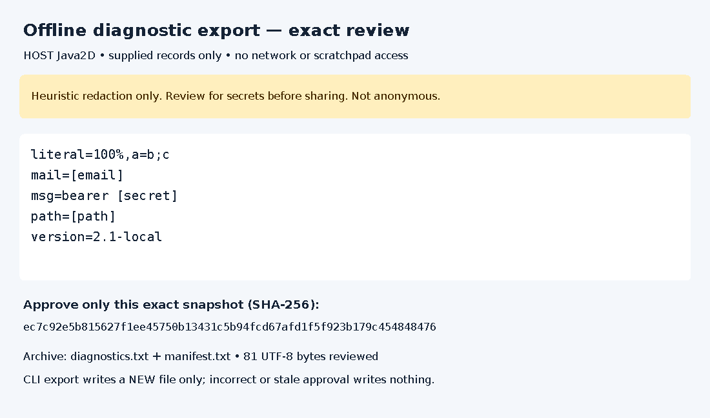

# R146 — 314-case JVM differential, message repair, offline diagnostic ZIP export

2026-11-27 · baseline `92bcd3278445af8467da5e3fd5cea7531b9815f4`.
**Partial delivery, not full v2.0/v2.1 completion or Class A.**

## Delivered and executed

* 20 new module production Kotlin files plus a repair to `MessageThread`, across
  21 modules. All are actually compiled with JVM target 17 and `-Werror`, then
  exercised by a production-API probe across 22 lanes.
* One additional module production file, `DiagnosticExportSession`, and a real
  operator CLI implementing explicit-input → allowlist → scrub → exact review →
  digest approval → new ZIP file. No collection, network or Android permission
  added. It does not access or enable exports from the separate scratchpad.
* 314 independent Python/JVM comparisons: **157 accepted, 157 refused, 0 mismatches**.
* W1 corpus wiring and W4 source-binding checks pass. W2 weakened geohash bound
  produces **1 mismatch**. W3 adapted old message graph logic produces **6
  mismatches**; raw baseline has missing-extension compile errors, so this
  control uses the explicitly documented lookup-only adapter.
* **336 focused Python unittest tests pass**: 319 oracle/corpus regression tests,
  7 runner-integrity tests, 10 real-JVM/file-export system tests. The JVM system
  exercise executes **39 assertions**, including stream failure and output
  bounds. These are different measures, not additive independent feature counts.
* Existing message-thread Python tests: **13 pass** (8 added in this revision).
* New password-history derivation uses **JCA PBKDF2-HMAC-SHA256, 600000 iterations**,
  domain FHC2, 256-bit output, checked against Python hashlib including UTF-8.
  The unshipped 1000-round SHA draft was replaced after review, despite agreeing
  tests. This is not a full authentication store or a memory-hard KDF.

“Independent” means a separately implemented Python reference, not an
independent author/auditor; corpus transport helpers are shared. Agreement can
miss shared specification mistakes. Fault controls reduce, but do not remove,
that risk.

## Per-feature runnable-code standard

“Yes” means substantive implementation and an executable behavioral check exist;
it does **not** mean the whole owning feature is finished. Every row below was
host-executed. Caps and refusal grammars are documented in each production file.
The 22-lane corpus covers accepted and refused cases in every lane, minimum 7
cases/lane (therefore exceeding the requested 5). One key mapper has two lanes.

| Owning module | Implementation / actual behavior | Substantial runnable code? | Corpus cases | Remaining feature boundary |
|---|---|---|---:|---|
| `:feature:alerts` | `InexactAlarmPlanner`: bounded inexact windows/batching | Yes | 17 | No AlarmManager delivery or reboot persistence |
| `:feature:accessibility` | `KeyToTouchMapper`: reserved chords, mappings/sequences | Yes | 11 + 7 | No Android overlay or input injection |
| `:format:pdf` | `PdfAnnotationPlan`: text/highlight/ink geometry | Yes | 13 | No PDF serialization, render, incremental save or signing |
| `:format:archive` | `CpioNewcParser`: read-only bounded newc index | Yes | 15 | No extraction, old/CRC/64-bit variants |
| `:format:psd` | `PsdThumbnailInspector`: bounded thumbnail resource inspection | Yes | 14 | No full PSD/thumbnail decoding |
| `:format:lok` | `OdfMetadataScrubber`: restricted flat metadata rewriting | Yes | 11 | Not arbitrary XML/ODF package anonymisation |
| `:feature:maps` | `GeohashCodec`: encode/decode/cell bounds | Yes | 28 | No map UI, tiles or geocoding |
| `:feature:find` | `QuerySynonymRingExpander`: bounded synonym expansion | Yes | 10 | No search-index/UI integration |
| `:feature:terminal` | `TerminalUrlDetector`: bounded HTTP(S) link detection | Yes | 13 | No browser navigation or complete terminal integration |
| `:feature:notes` | `NoteTagHierarchy`: normalized path-tag indexing/queries | Yes | 11 | No persistent note database/UI |
| `:feature:together` | `EditLogCoalescer`: sequential replay-preserving compaction | Yes | 22 | Not concurrent CRDT merge, transport or persistence |
| `:privacy` | `DiagnosticExportAllowlist`: selected-key sorted/scrubbed export | Yes | 19 | Heuristic patterns; human review required |
| `:feature:automation` | `MacroExchangeCodec`: canonical FMC1 import/export | Yes | 15 | No execution or device bridge |
| `:cast:airplay` | `NtpTimestampCodec`: NTP era conversion | Yes | 16 | Not AirPlay transport, pairing or audio sync acceptance |
| `:core:model` | `DurationPhraseParser`: bounded duration grammar | Yes | 17 | No timers/reminder service integration |
| `:feature:media` | `QueueShufflePlanner`: deterministic queue shuffle | Yes | 14 | No player persistence/UI |
| `:feature:browser` | `SubresourceIntegrityParser`: strict SRI metadata parse | Yes | 14 | No subresource download/digest enforcement |
| `:core:hw` | `OemThrottleDetector`: supplied-series episode analysis | Yes | 13 | No live hardware sampling or calibrated cause inference |
| `:feature:vault` | `PasswordHistoryHashChain`: FHC2 PBKDF2 history reuse/prune | Yes | 12 | Salt generation, storage, rate limiting and worker dispatch not integrated |
| `:feature:capture` | `DuplicateFrameDetector`: fingerprint/time duplicate analysis | Yes | 11 | No pixel capture, live encoder integration or universal equality proof |
| `:feature:messages` | `MessageThread`: two-pass forward-parent/cycle repair | Yes | 11 | Existing duplicate-ID/list policy retained; no full messenger delivery |
| `:privacy` + operator tool | `DiagnosticExportSession` + `DiagnosticExportCli`: actual reviewed ZIP publication | Yes | 10 system tests, 39 JVM assertions | Host CLI, not Android provider/UI acceptance; no crash-safe atomic publication claim |

These represent 21 module owners, not 22 newly completed full modules. The CLI
is an operator tool, not a new Gradle module. Existing good features remain.

## Reproduction

From `android/`, with pinned host tools installed:

```sh
python3 tools/bootstrap_host_tools.py install
python3 tools/run_r146_checks.py
python3 -m unittest discover -s tools -p 'test_r146_*.py'
python3 -m unittest discover -s tools -p test_message_thread.py
python3 tools/module_testability.py --check
python3 tools/check_project.py --keep
# Broad suite currently exits 1 on documented baseline failures:
python3 -m unittest discover -s tools -v
```

The differential uses pinned compiler 2.2.21 and the jdk4py 17.0.9.2 package
(JRE 17.0.9) from the existing bootstrap cache. This old JRE is for disposable
host tests only, not a supported production runtime; use a maintained JDK17 for
real deployment. The npm compiler mirror is integrity-pinned but not independently
authenticated upstream. Tests do not auto-download missing tools; system tests skip
explicitly if the pinned toolchain is absent. Check the skip count before citing
JVM evidence. Do not treat oracle-vector pins alone as production execution.
`.github/workflows/host-r146.yml` adds a dedicated CI gate for these checks;
it is authored here, and no remote CI pass is claimed. Existing Android and
broad-suite gates are retained.

### Use the offline diagnostic workflow

Create your own UTF-8 file, one `key=literal-value` per line. Values are literal,
not percent escapes. Only explicitly allowlisted keys are included. Do not feed
raw production secrets to test tools. Example using deliberately non-sensitive
operator-supplied records:

```sh
printf 'version=2.1-local\nmode=offline\n' > /tmp/osb-records.txt
python3 tools/diagnostic_export.py version,mode /tmp/osb-records.txt
# Read the exact review. Copy its SHA256 only after reviewing it:
python3 tools/diagnostic_export.py version,mode /tmp/osb-records.txt REVIEW_SHA256 /tmp/new-diagnostics.zip
```

`REVIEW_SHA256` above is an instruction placeholder, not a usable digest. The
second command succeeds only with the actual digest from the first and a NEW
destination. Changed selected output, wrong digest, duplicate keys, invalid UTF-8,
selected control characters, oversized fields or an existing/symlink destination
refuse. Archive entries are exactly `diagnostics.txt` and `manifest.txt`, with
format FDE1, content SHA256, byte count, and the heuristic-redaction warning.
Digest approval binds reviewed output, not all excluded input records or the
identity of the operator. File input/output is host-local, not secure deletion.

## Real visual inspection



Rendered by `R146SystemChecks`, using the actual `DiagnosticExportSession` text
for deliberately supplied test records. Opened and inspected: header, local-only
scope, warning, five review lines, full 64-digit approval hash, byte count and
NEW-file restriction are visible without clipping. Font-metric width checks also
ran. This is **host Java2D, not an Android screenshot or an interactive app UI**.
No image-generation service, fake device frame or simulated telemetry was used.
The ZIP is independently parsed by Python `zipfile`, with CRC, exact entry list,
exact review bytes, byte count, SHA256 and secret omission checks.

## Regression gate (honestly red baseline)

| Run | Tests | Failures | Errors | Skips | Exit |
|---|---:|---:|---:|---:|---:|
| Before edits | 3062 | 12 | 4 | 443 | 1 |
| R146 candidate | 3406 | 11 | 3 | 443 | 1 |

Compared failure/error **identities**, not just totals: **0 new**, 2 resolved
(stale module-census evidence and stale native-source inventory). Remaining:
`test_r43_tools`, `test_r45_tools`, `test_r46_tools` loader errors; 10
`test_r119_legacy_stats` failures; the existing `SemVer` redeclaration failure in
`test_r38_tools`. This is not a green whole-project build. Source validation
`check_project.py --keep` passes; it does not compile Android or run Gradle.
No existing test was disabled or expectations weakened to conceal these failures.

The census had stale hashes for `VersionRange.kt` and `LauncherFrecencyRanker.kt`
before this work. Their evidence bindings and the native inventory were refreshed
without modifying those sources or claiming new behavioral acceptance. The
existing launcher Python check ran (1 pass); that is not JVM verification of it.
The full generated native inventory is structural ownership evidence, not review
of every previously inventoried implementation.

## Absolute and percentage accounting

| Standard | Absolute | Percent |
|---|---:|---:|
| Included modules with substantial runnable subset | 50 / 50 | 100.00% |
| Modules lacking such an established subset | 0 / 50 | 0.00% |
| Full original-spec Class-A accepted modules | 0 / 50 | 0.00% |
| Modules still unfinished at full original scope | 50 / 50 | 100.00% |
| Requirement rows marked verified | 0 / 231 | 0.00% |

Per-module **all-50** source/check/limit declarations are in
[MODULE-TESTABILITY](MODULE-TESTABILITY.md), SHA-bound to
`module-testability.json`. These are reviewed subset claims, not inference from
folder/file counts. Requirement statuses stay 221 partial_unverified, 6
not_implemented, 3 excluded, 1 superseded. No row is promoted by this revision.

Quantity exceeds the recorded R144 10-kernel and R145 15-kernel increments;
quality now includes actual Kotlin compilation/differential execution, a real
file workflow, independent artifact readback, negative controls and an inspected
visual artifact. This does **not** satisfy the user's ultimate all-features-A
request; most new slices still require Android integration. See
[R146-PLAN A–J](R146-PLAN.md) for assumptions, adversaries, counterexamples,
retrieved references and the explicit H∂ stopping frontier.
