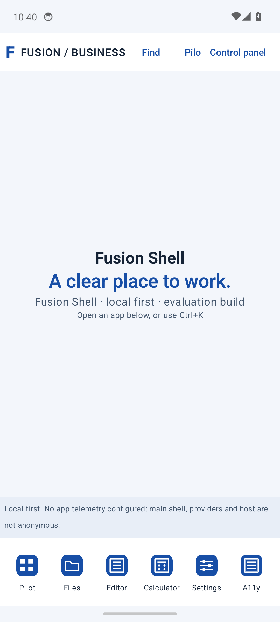
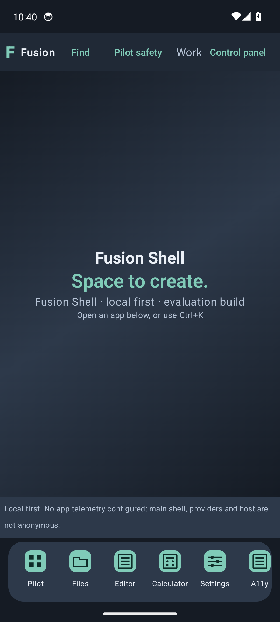

# R24 — native professional desktop and safer document/input subsets

2026-10-17 · branch **`arena/f77cb2a6-osb`** · native-tested candidate **`23e8868bf2d23a26f29f0fcc6a7dc592d429069b`**.

**Implemented and actually tested subsets, NOT all-original-spec A-grade completion.** Exact candidate23e8868
passed desktop9, PDF/boundary27, CSV8, privacy18 on BOTH API34/API37, and the full main133-case workflow.
Both main builds/JVM/contracts/lint and privacy builds/lint passed. Earlier parent-workflow bookkeeping
lag was retained provisionally, then actually finalizedSUCCESS; the completed receipt is now collected.
No failed/partial run was relabeled green.

## Professional palettes and Business / Art

Both palettes work with either layout. Real controls exist in **Control panel** (top right) and **Settings**; one observable preference graph drives both. Changes preserve current window IDs/dirty editor data and normal Activity recreation state. Not a change to the host/Android theme, permissions, experiment consent or keyboard preset.

| Palette | Semantic colors | Actual behavior |
|---|---|---|
|**Office Blue**|Cool light background `#F3F6FB`, white surfaces, ink `#152336`, blue `#174EA6`|Clean office-oriented light chrome, readable role-based controls|
|**Studio Graphite**|Graphite `#151B24`, slate surfaces `#202936`, light text `#ECF1F8`, teal `#80CBB8`|Professional dark chrome, not a neon/gaming theme|

- **Business:** full-width bottom own-app taskbar, real running/active indicators, window focus/restore controls and familiar right-side window actions.
- **Art:** centered rounded scrollable dock containing all Fusion app entries, neighboring magnification, running dots, active-app top title and left-side close/minimize/maximize controls. All apps also reachable with Find/Ctrl+K. Not macOS/Windows or third-party task/window authority.
- **Actual mouse and real keyboard focus** magnify glyphs to≤1.25× without changing64dp hit slots. Magnification-off restores1.0; no oversized drawing over a tiny hitbox. Renderer/raster checks—not only a stored enum—passed.
- Real local clock and workspace controls. No fake Wi-Fi/Bluetooth/boost/entitlement toggles. Two palettes are independent of layout; document/PDF/image content is not recolored.
- Opaque sRGB role text pairs meet4.5:1 model checks; actual2× system-font density/search reachability passed. This is NOT a whole-product TalkBack/Switch/Voice/HDR/high-contrast certificate.

### Actual native captures, not generated mockups

These are downsampled real managed-Android screenshots from the same tested candidate; checksum, PNG chunks/CRC/deflate/dimensions verified before local viewing. Portrait AVD, not a physical desktop. All4 combinations executed; two representative previews mirrored locally.

**Business / Office Blue**



**Art / Studio Graphite**



Earlier image transport was refused for truncated/missing chunks; no guessed base64 padding or AI reference image replaced native evidence.

## Productivity and privacy changes

### Real keyboard-visible Task / Notes actions

Pinned genuine save/New/reload toolbars outside scrolling warning/status/form bodies. Forms are field-first with short plaintext warnings; full limits remain and experimental consent still discloses scope. IME fit is a **transient rendering**, not permanent destruction of normal stored window bounds.

New standalone tests have NO Compose text-input interceptor: actual Android accessibility text entry, real platform IME/insets/bounds, native scrolling and **one actual submit touch**. Business and Art both produced actual revision1 with exactly one correctly titled task. Success observes the real revision-checked file, not an offscreen status label. Native Notes New/cancel produced the actual discard dialog and retained dirty text. Original R18 edit/archive/recreate/restore/query workflow is retained, not deleted or given a larger timeout.

This is not reminders/recurrence/sync/full productivity completion, a universal UI-stability theorem or proof of the historical R23 timeout's precise cause.

### Native isolated readonly PDF preview

New **Isolated PDF preview** (`pdf-preview`) is a separately consent-gated route; original full PDF editing remains blocked.

- Real platform **PdfRenderer runs only in the isolated child worker**, not the trusted parent UI parser. Fresh owned seekable regular readonly FD, source unlinked before transfer, no URI/network/output path authority.
- Source≤2MiB,≤1024pages, native page dimensions≤14400points, preview≤320×320 opaque ARGB pixels (≤409600raw bytes). Parent validates raw pixels and never decodes child-controlled PNG/JPEG.
- Correlated source/page metadata, serialized document renders, immutable requested-page check and rapid Prev/Next/Prev attack. Actual Android PDF producer/golden magenta/cyan page pixels, distinct UID, malformed/oversize/writable/memory/wrong-page refusal/recovery, real system picker and original bytes unchanged all passed.
- Existing CSV/XLSX/shared-memory/readonly-FD/private-path/socket/watchdog gates retained. **No increased5s worker/8s reply deadline.** Dense old regressions exposed deadline deaths; exact-empty UTF8 fast paths remove unnecessary encoders/decoders while preserving strict nonempty semantics and empty-table/row/cell distinctions.

Not full PDF/Office/LOK editing/signing/export/fidelity, hostile-parent immutability, arbitrary-worker honesty, no-swap or secure erasure. PDF uses the explicit file route; the existing worksheet memory APIs still have no named-input fallback. No blanket claim all formats are isolated.

### Privacy on actual API34 AND API37

Separate no-INTERNET scratchpad/no-IME pad now also handles trusted dynamically registered noninteractive-state events. Real sleep/wake discards revealed code; stale buttons cannot reenter it; ordinary UID cannot spoof protected screen-off broadcast. Actual runtime is checked against the runner argument, not compileSdk constant.

Both full18-case privacy workflows passed on managed API34 and released API37.0 Google images. This closes a **bounded privacy runtime37** verification gap—not all main-app API37 features, the Rabbit1 GUI, physical/OEM/hardware or hostile external AX/overlay tests.

A pointer pad only helps against keyboard-only recording under trusted Android/host/AX/pointer assumptions. Host/hypervisor/firmware/camera or passive implants remain outside app authority. UI timers/clear/unlink/anonymous memory are not hard-real-time or forensic erasure. Main app is network-capable and not anonymous; its overbroad old “nothing leaves unless shared” message was corrected.

## Exact observed verification

| Same source candidate23e8868 | PASS / FAIL / SKIP | Whole workflow |
|---|---:|---|
|[Desktop/input39075701917](https://github.com/jyvplay/OSB/actions/runs/39075701917)|9 /0 /0|SUCCESS|
|[PDF + retained boundary39075701922](https://github.com/jyvplay/OSB/actions/runs/39075701922)|27 /0 /0|SUCCESS|
|[CSV regression39075701921](https://github.com/jyvplay/OSB/actions/runs/39075701921)|8 /0 /0|SUCCESS|
|[Privacy API34/39075701923](https://github.com/jyvplay/OSB/actions/runs/39075701923)|18 /0 /0|SUCCESS|
|[Privacy API37/39075701918](https://github.com/jyvplay/OSB/actions/runs/39075701918)|18 /0 /0|SUCCESS, actual runtime37 asserted|
|[Full main39075701942](https://github.com/jyvplay/OSB/actions/runs/39075701942)|133 /0 /0|SUCCESS, completed aggregate receipt collected|

Focused9/27/8 overlap full133; do NOT add as independent methods. Main plus privacy =151 distinct methods on API34; the same18 privacy methods separately ran on API37. Earlier failures are retained: compiler0cases, UI5/2, full126/5, UI5/4, full129/4, UI7/2, boundary26/1 and CSV7/1. No unchanged rerun-to-green, skipped failing case or broadened timeout produced the final subsets.

Latest complete SDK-free pipeline: **exit0,162.067s,158 Python methods**, separately compiled real Kotlin2.2.21 production policies/consumer, **65074 R24 assertions**,8 appearance combinations/16640dock configurations/2688input presentations plus strict UTF8 differential/dense-frame attacks. R23 kernels898161 assertions/160000four-event words, R22 checks37, R21 checks376 and Office references327 (271accepted/56refused/15equal-byte pairs) also passed. These are bounded models/corpora, not full Office/AX/hardware proofs.

[Machine-readable outcome](verification/r24-outcome.json) · [latest host output](verification/r24-host-final.txt) · [A–J record](R24-ENGINEERING.md) · [preimplementation plan](R24-PLAN.md).

## Absolute module accounting

| Standard | Absolute | Percentage |
|---|---:|---:|
|Substantial source/test-paired runnable subsets, cumulative|48/49|97.96%|
|Unestablished substantial subset: `:format:lok`|1/49|2.04%|
|Fully ORIGINAL-specification accepted|0/49|0%|
|Still unfinished at full requested scope|49/49|100%|
|Existing production modules materially deepened in R24|11/49|22.45% inventory touched, NOT effort/completion|

No new Gradle module was invented to inflate the denominator. The11 are:

| Module | New substantial code / runnable evidence | Exact limit |
|---|---|---|
|`:app`|Native Business/Art chrome/control panel/own-app dock; desktop9|Not stock OS/third-party compositor|
|`:core:designsystem`|Two role palettes/contrast/dock scale; real compiler + raster|Opaque math + finite rendered traces, not full AX|
|`:core:settings`|Typed schema/observable graph/corrupt-type/atomic-patch refusal; native UI|SharedPreferences normal persistence, not DataStore/power-loss proof|
|`:core:windowing`|Transient input presentation;2688 real-compiled model cases|Tiny rectangle fit≠every form usable|
|`:core:model`|Old full PDF blocked / new preview exact consent; policy attacks|No original feature/spike silently promoted|
|`:feature:settings`|Shared controls/2× density/search/native state|Full registry/history/import/OEM guide incomplete|
|`:feature:automation`|Pinned save/input layout; single real tap + actual task file|No reminders/recurrence/sync|
|`:feature:notes`|Pinned New/Save/actual IME dirty-draft confirmation/cancel|Plaintext; complete recovery/security gates separate|
|`:privacy`|Protected power-state lifecycle; actual18 cases/API34+37|No host/hardware attestation/anonymity/erasure|
|`:format:pdf`|Real isolated native render/raw frame/picker; boundary27|Explicit bounded readonly preview only|
|`:format:ooxml`|Exact-empty strict UTF8 allocation fast path/differential + dense cases|Not full Office or universal5s guarantee|

[Detailed cumulative source/test hash census](MODULE-TESTABILITY.md) follows the established R23 testability standard with R24 bindings; its title is not a new pass/completeness inference.

## Lightweight / browser / Office alternatives and exact remaining gaps

- No large icon pack, font bundle or new Office engine binary was added. Actual remote compressed APK observations: privacy **2,537,164bytes**, main play **29,102,363bytes**, main pro **29,102,435bytes** (hashes in outcome JSON). These are NOT installed size/app RSS/whole Android/host/Tails footprint. No meaningful speedup or lighter-than-Tails-system claim.
- Real readonly host sysfs observation: USBUNKNOWN, IOMMU directorycount0 in THIS sandbox, no writes/safe verdict. Real host ELF23,971,072B is x86_64 and fails strict16K-header condition; wrapper JAR contains no native engine. Neither is an integrated Android browser/Office engine or expert legal clearance.
- Mechanism-distinct [engine portfolio](R24-ENGINE-PORTFOLIO.md) includes platform preview, full pinned least-authority engine, surfaces/tiles, network broker, conversion, separately consented remote engine, native productivity and whole-host trust—with artifacts, falsifiers and local/original gaps. Raw4K RGBA60Hz≈1.99GB/s bound explains why a full frame cannot be a single Binder reply.
- [Fresh privacy PRD](R24-PRIVACY-PRD.md) and [primary research ledger](research/r24-primary.md): no ordinary APK can attest a passive logger/host firmware or anonymize prior chat/GitHub/ISP logs. Generic engine+Tor is not Tor Browser. Exact binaries/ABI/16K/fidelity/fonts/transitive licenses, S29/S30, physical/AX/OEM and full requested modules remain unaccepted.

## Try on your laptop / without Studio

Open **`OSB/android`** in Rabbit1 with maintained full JDK17 and SDK package **`platforms;android-37.0`**. AGP9.1.1/Gradle9.3.1/Kotlin2.2.21, min34/compile37/target37. Temporary documented legacy Kotlin/DSL bridge remains; not an AGP10 migration. Rabbit1 GUI itself was not run here.

Run `app/proDebug`; accept evaluation with copied data. **Control panel → Business/Art + palette**, or open Settings app from taskbar/dock/Find. Art hover/focus zoom is independently switchable. Find “Isolated PDF preview” for the bounded PDF experiment; the old full PDF remains unavailable. For private input run separate `privacy/debug` APK. Use disposable AVD/data, not real secrets on an untrusted laptop.

```sh
cd android
python3 tools/bootstrap_host_tools.py install # Linux x86_64 explicit optional downloads
python3 tools/r24_lab.py host --tools "$HOME/.cache/fusion-host-r23"
# With REAL maintained JDK17+SDK (host cache is old JRE, not JDK):
python3 tools/r24_lab.py android
python3 tools/r24_lab.py device --suite ui --disposable
python3 tools/r24_lab.py device --suite pdf --disposable
python3 tools/r24_lab.py device --suite full --disposable
```

Local native CLI routes were NOT executed without SDK/javac. Their corresponding real commands ran in remote CI; no mocked Android APIs/simulated functionality, independent agents, physical lab or new theorem-prover result claimed. Full acceptance remains0/49 even with every named bounded gate now green.

Reproduction-only final correction: the full native CLI now uses the SAME dedicated `VisualCaptureTest`
exclusion as the actually executed CI133-case command. That separate manual capture class needs run/font
arguments and was never part of this normal regression set; no failing functional case was removed.
This script/source contract was rechecked, not a new local Android execution or new APK build.

Reporting provenance: [native/build/test input comparison](verification/r24-native-inputs-at-report.json)
binds the final report to tested23e8868. Only the explicitly checked CLI manual-capture exclusion and
its new source-contract test differ among non-doc Android inputs; no APK Kotlin/manifest/resource,
Gradle/version/wrapper/workflow/Android-test body changed. Reporting/unit158/host exit0 were re-executed;
no separate native build at a later report-only commit is claimed. Earlier pending/failed raw receipts
remain immutable history, not current acceptance or images manufactured from missing chunks.
